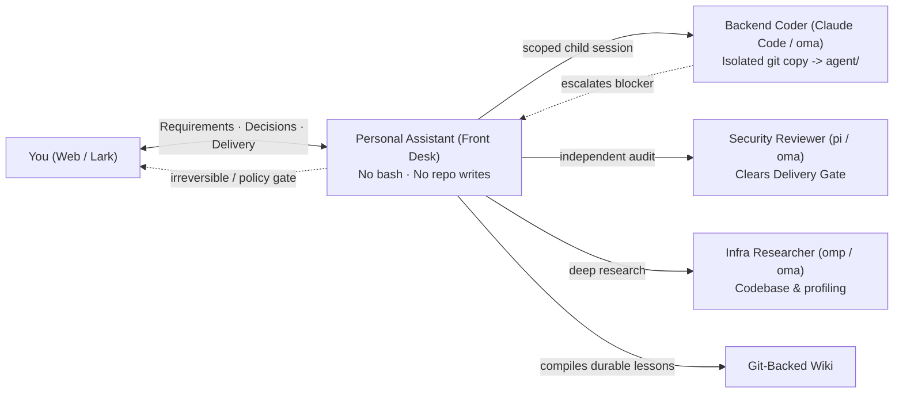
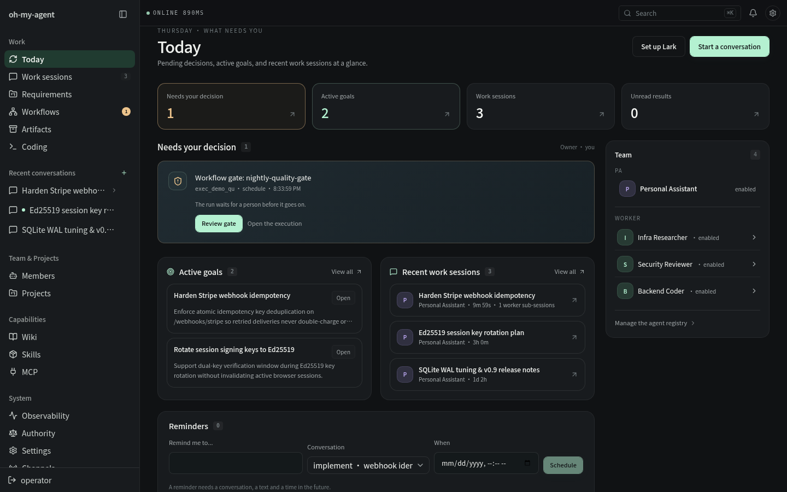
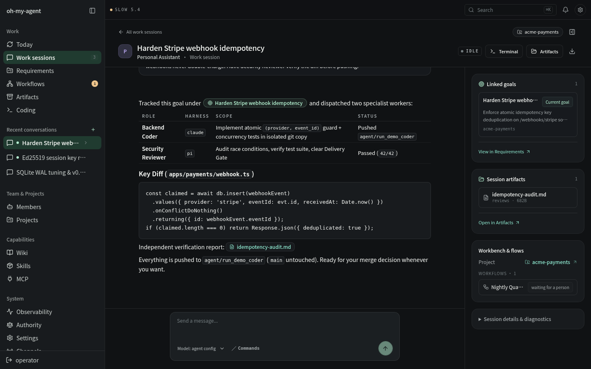
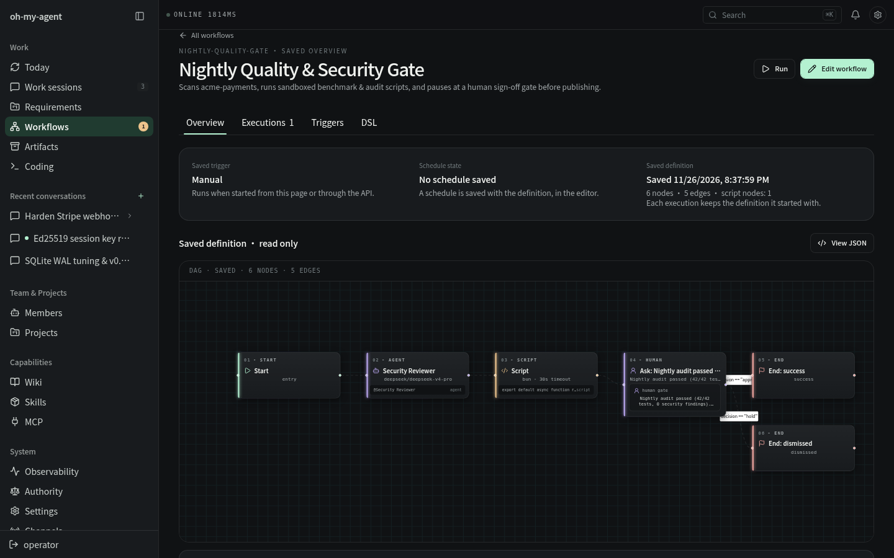
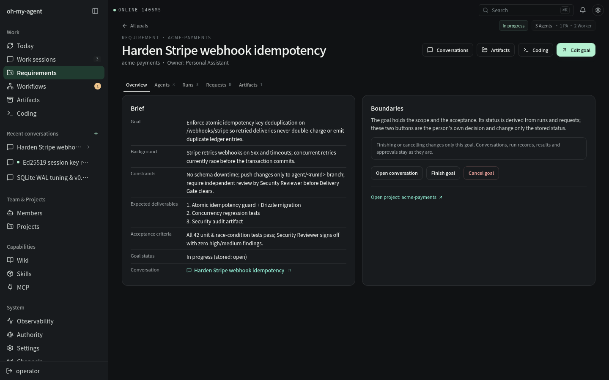
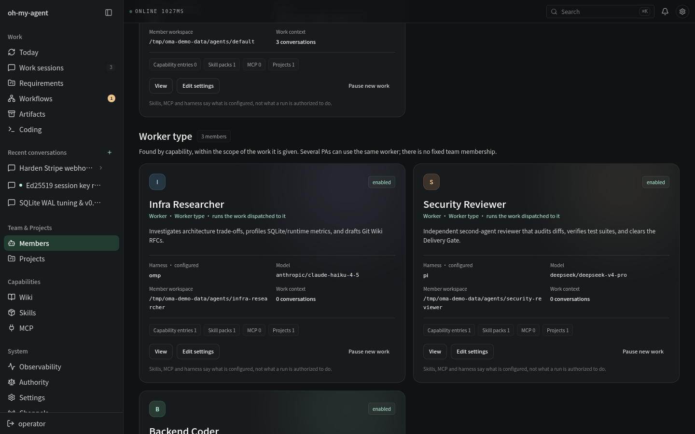
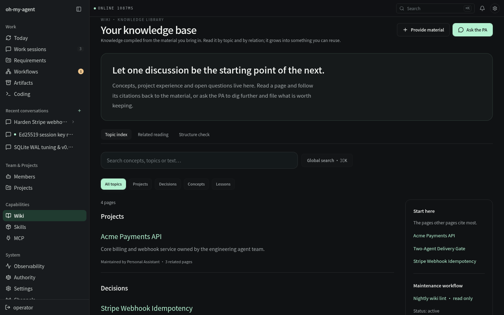
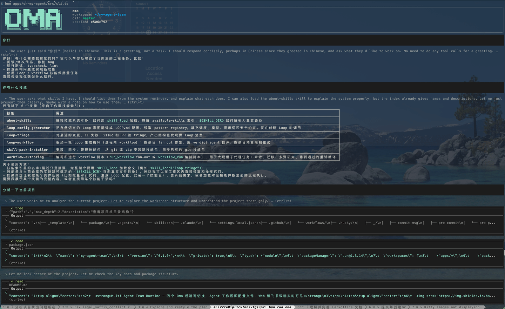
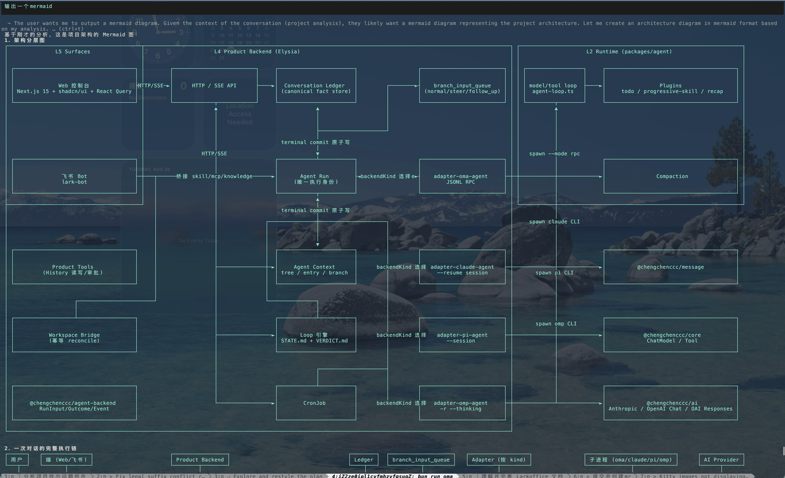
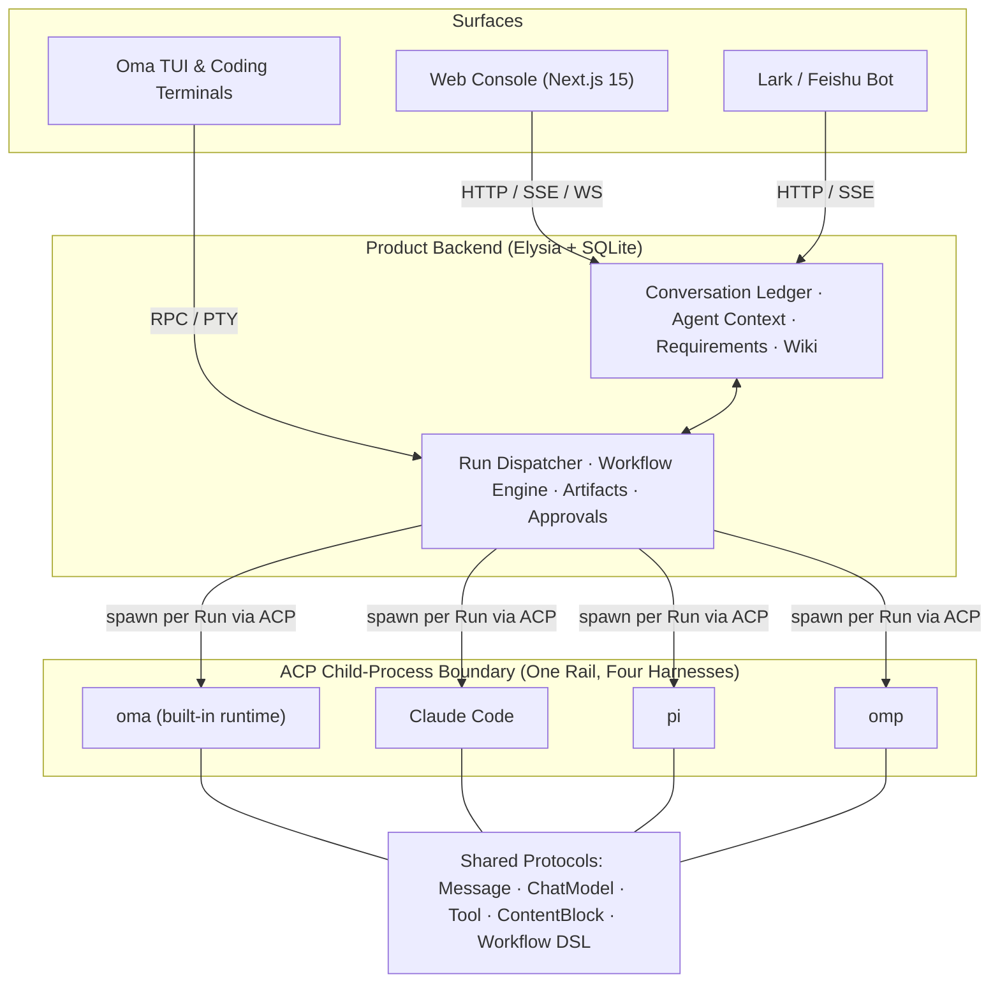

<div align="center">

# CrewDesk

**Run a self-hosted AI engineering team — one Super Assistant, specialist coding agents across 4 harnesses (`oma` · Claude Code · `pi` · `omp`), a git-backed Wiki, and real-time Web + Lark sync.**

**English** · [简体中文](README.zh-CN.md)

[](https://bun.sh)
[](https://www.typescriptlang.org)
[](https://nextjs.org)
[](https://www.sqlite.org)
[](https://www.npmjs.com/package/@chengchenccc/oh-my-agent?activeTab=versions)
[](https://www.npmjs.com/package/@chengchenccc/oh-my-agent)
[](LICENSE)
[](https://github.com/Chengchcc/crewdesk/actions/workflows/ci.yml)

[PA + Worker Model](#-the-pa--worker-team-model) · [Skills + MCP](#-operate-the-console-via-chat-skills--product-mcp) · [Screenshots](#-screenshots) · [Quick Start](#-quick-start) · [Architecture](#-architecture) · [Security](#-security-model) · [Docs](#-documentation)

<br />

<a href="https://github.com/Chengchcc/crewdesk/releases/download/media-assets/demo-main-flow.mp4">
  
</a>

<sub>End-to-end walkthrough: Today → Chat & Artifacts → Tracked Requirements → 4-Harness Team → Workflow DAG → Git Wiki · <a href="https://github.com/Chengchcc/crewdesk/releases/download/media-assets/demo-main-flow.mp4">Download full HD MP4</a></sub>

</div>

---

Most coding agents live in an isolated terminal tab. **CrewDesk** turns them into a coordinated, self-hosted team on a single Bun + SQLite stack:

- Talk to a **Personal Assistant (PA)** from Web or Lark/Feishu.
- The PA tracks goals as **Requirements**, dispatches specialist workers (Coder, Researcher, Reviewer) into isolated git workspaces, and compiles long-term knowledge into a **git-backed Wiki**.
- Mix **`oma`**, **Claude Code**, **`pi`**, and **`omp`** on the same team over one Agent Client Protocol (ACP) rail — with fail-closed approvals, sandboxed workflows, and zero external database infrastructure.

## 👥 The PA + Worker Team Model

Most coding agents put chat, planning, shell execution, and git writes inside one omnipotent loop — one misunderstanding silently mutates your repository or buries your chat in tool noise.

**CrewDesk** enforces a hard organizational boundary in code (not just system prompts): **one Personal Assistant (PA)** manages your attention at the front desk, while **Specialist Workers** execute in isolated workshops.



### Who Does What (Enforced by Runtime & Tool Boundaries)

| Role | What it owns | Hard boundary (enforced in code) |
|---|---|---|
| **You (Human)** | Team roster, permissions, irreversible approvals, merge & acceptance decisions. | Agents can **propose** new projects, workflows, or member settings — nothing is saved or merged without your explicit confirmation. |
| **Personal Assistant (PA / Front Desk)** | Your attention & main conversation: clarifies intent, turns real goals into tracked **Requirements**, selects workers by capability, monitors progress, answers worker questions from context/Wiki, and compiles knowledge into the **Git Wiki**. | **Physically has no execution tools** (`bash`, `write`, `edit`, `read`, `eval`, browser). It cannot silently inspect or hack your codebase — any work outside the conversation must be dispatched to a worker. |
| **Specialist Workers** (Coder, Reviewer, Researcher, ...) | Deep execution inside **isolated child conversations** and **isolated git project copies** using any harness (`oma`, `Claude Code`, `pi`, `omp`) with per-worker `SOUL.md`, skills, and MCP servers. | Cannot talk to you uninvited (unless you explicitly step in via direct line or worktree terminal); `project_push` only pushes `agent/<runId>` branches (pushing `main`/`master` is rejected); `deny_write_paths` & `deny_commands` block workspace escape. |

### How One Request Flows End-to-End

1. **You talk to the PA** in Web or Lark/Feishu (e.g., *"Harden `/webhooks/stripe` with atomic idempotency keys and have Security Reviewer verify it"*).
2. **Track & Dispatch** — The PA creates a tracked **Requirement** (goal, constraints, acceptance criteria) and dispatches a **Coder** into an isolated child session and isolated git worktree.
3. **Escalation & Fail-Closed Approvals** — If a worker hits a missing detail, the PA answers from the brief/Wiki or escalates to you as a persistent decision card; high-risk shell/file actions pause on **fail-closed** approval cards (timeout = deny).
4. **Two-Agent Delivery Gate** — The Coder pushes only to `agent/<runId>` and emits typed `artifacts://`. Until a second worker (e.g., **Reviewer**) independently verifies the diff and tests, the backend automatically stamps the delivery **Unverified**. You decide whether to merge.
5. **Knowledge Compounds in Git** — Decisions, root causes, and architectural lessons are committed to the shared **Git Wiki** with source citations — instead of evaporating inside chat logs.

## 🎛 Operate the Console via Chat (Skills + Product MCP)

In CrewDesk, conversation isn't only for coding tasks — **you operate the control plane itself through chat**.

Resource editors (Members, Projects, Workflows) embed a live PA side-panel next to the form. Type `/` to invoke progressive **Skills** from `skills/`, backed by three per-Run **Product MCP** servers (`product-tools`, `agent-config`, `workflow`) authenticated with single-Run bearer tokens that are revoked on settle.

**Propose ≠ Save**: agents never silently overwrite live team config, project bindings, or workflow DAGs. Every mutation returns a field-by-field **Proposal Card** (`Adopt to form` → review → explicit `Save`).

| Slash Skill | Role | Product MCP Tools | What you can do in chat |
|---|---|---|---|
| `/member_manage` | PA | `team_list`, `agent_read`, `agent_write`, `agent_create` | Inspect the team roster and propose adding or updating a member's harness, model, role, or write-path policy. |
| `/project_manage` | PA | `project_list`, `project_detail`, `project_propose`, `project_attach` | Register/edit Git projects and bind repos to workers (with human approval). |
| `/requirement_memory` | PA | `requirement_track`, `requirement_query` | Create, update, and recall durable **Requirements** (goals, constraints, acceptance criteria) across conversations. |
| `/team_dispatch` | PA | `dispatch`, `steer_worker`, `cancel_worker`, `answer_worker_request`, `ask_question`, `todo_write`, `artifact_*`, `history_*` | Decompose multi-step plans, dispatch or steer/cancel live workers, answer worker blockers with evidence, and inspect artifacts. |
| `/wiki_manage` | PA | `wiki_query`, `wiki_read`, `wiki_create`, `wiki_patch`, `wiki_lint`, `wiki_source_add` | Search, ingest source citations, safely CAS-patch pages, and run health checks across the shared Git Wiki. |
| `/reminder_manage` | PA | `remind_me`, `reminder_list`, `reminder_cancel` | Schedule, inspect, or cancel one-shot and recurring UTC cron reminders in the current conversation. |
| `/workflow_design` | PA & Worker | `workflow_read`, `workflow_write` | Generate and schema-validate `*.workflow.json` DAGs (`parseWorkflow`), surfaced in the editor as an unsaved proposal. |
| `/worker_delivery` | Worker | `report`, `handback`, `project_push`, `artifact_upload`, `todo_write` | Report progress/blockers with verification status, hand back out-of-scope tasks, and deliver `agent/<runId>` branches + typed artifacts. |
| `/agent_doctor` | Worker | Workspace memory + conversation ledger inspection | Diagnose another teammate's context drift against canonical ledger facts and propose targeted fixes without mutating its memory. |
| `/agent_fanout` | Worker | `task` (batch fan-out up to 64 items / 8 concurrent), `workflow_run` | Run parallel subagent audits, migrations, multi-source research, and fix-until-pass orchestration scripts inside a sandboxed VM. |

> Builtin skills are **role-scoped** (`roles: front` vs `roles: worker` in `SKILL.md` frontmatter) so the PA only sees control-plane skills it can actually execute while workers see execution and delivery skills across all four harnesses (`oma`, Claude Code, `pi`, `omp`). Skills load progressively in two stages (`skill_load` + `${SKILL_DIR}`), and you can mount external MCP servers or install custom skill packs from Git/ZIP per agent.

## ✨ Why CrewDesk

| Capability | What you get |
|---|---|
| **One ACP Rail, Four Coding Harnesses** | Assign **`oma`** (built-in CLI/TUI runtime), **Claude Code**, **`pi`**, or **`omp`** per agent. Each harness keeps its own native session continuity behind one unified ACP child-process boundary — swap engines without changing your console, Lark bot, or approval flow. |
| **Workspace-as-Config & Git Wiki** | Every agent's identity (`SOUL.md`, `USER.md`), skills, MCP servers, and memory are plain files in its workspace. Durable knowledge lives in a product-level git-backed **Wiki** (`raw/` references + compiled topic pages), rather than decaying inside chat history. |
| **One Ledger, Every Surface in Sync** | Web Console, Lark/Feishu IM bot, Oma TUI, and in-browser **Coding** worktree terminals all project the same SQLite conversation ledger. Start a task in Lark on mobile, approve a tool call or inspect artifacts in Web, and jump into the agent's worktree terminal in one click. |
| **Fail-Closed Approvals & Guardrails** | Per-agent tool policies (`ask` / `auto` / `deny`), path & command fences (`deny_write_paths`, `allow_write_paths`, `deny_commands`), and persistent HITL prompts (`pending_action`) that deny on timeout. |
| **Declarative Agentic Workflows** | Visual DAG orchestrator with `agent`, `script` (bubblewrap-sandboxed), and `human` nodes, JSON-Logic conditional routing, cron triggers, and typed `artifacts://` passed between stages. |
| **Zero-Infra Self-Hosting** | Single Bun + SQLite runtime. No Docker Compose sprawl, no Postgres, no Redis. |

## 📸 Screenshots

<table>
  <tr>
    <td width="50%">
      
      <br /><sub><b>Today Inbox</b> — pending human gates, active goals, work sessions & team roster</sub>
    </td>
    <td width="50%">
      
      <br /><sub><b>Chat Console</b> — PA dispatch table, inline Requirement & Artifact chips, right-rail inspector</sub>
    </td>
  </tr>
  <tr>
    <td width="50%">
      
      <br /><sub><b>Agentic Workflow DAG</b> — agent, sandboxed script, and human-in-the-loop gate nodes</sub>
    </td>
    <td width="50%">
      
      <br /><sub><b>Tracked Requirements</b> — goals, constraints, acceptance criteria & linked runs/artifacts</sub>
    </td>
  </tr>
</table>

<details>
<summary>More screenshots (Multi-Harness Team, Git-Backed Wiki, Oma TUI)</summary>

<br />

| Multi-Harness Team (`oma` · `claude` · `pi` · `omp`) | Git-Backed LLM Wiki |
|---|---|
|  |  |

| Oma TUI — Interactive Session | Oma TUI — Tool Calls & Mermaid |
|---|---|
|  |  |

</details>

## 🚀 Quick Start

### Option 1: Prebuilt CLI + Gateway (Fastest)

Install `oma` together with the prebuilt backend + web gateway bundle (requires `tar` and `zstd`; Bun is installed automatically if missing):

```bash
curl -fsSL https://raw.githubusercontent.com/Chengchcc/crewdesk/master/scripts/install.sh | OMA_VERSION=rc sh
oma gateway up        # foreground; use `oma gateway up -d` for background
```

> `OMA_VERSION=rc` pulls the npm `rc` channel while `oma gateway` is in release candidate. The installer downloads the bundle to `~/.oma/gateway/` and never auto-starts services.

Open `http://127.0.0.1:3001/login` and sign in with the password printed by `oma gateway up` (stored with `0600` permissions in `~/.oma/gateway-secrets.json`). You can change it in **Settings → Login password** or via `oma gateway passwd`.

**Common commands:**

| Command | Action |
|---|---|
| `oma gateway up` / `up -d` | Start backend + web (foreground / background, returns once healthy) |
| `oma gateway status` | Show installed version, process health, and login password |
| `oma gateway down` | Stop background gateway |
| `oma update` | Upgrade CLI and gateway bundle together (`--check` to inspect only) |
| `oma -p "Summarize docs/architecture/README.md in 3 bullets"` | Run a one-shot CLI prompt with `oma` |

Manual install: `bun add -g @chengchenccc/oh-my-agent@rc && oma gateway fetch && oma gateway up` (`fetch` is required because Bun skips dependency postinstall scripts by default). Code (`~/.oma/gateway/`) and state (`~/.oma/gateway-data/`) are stored separately so upgrades preserve your data.

### Option 2: Run from Source

**1. Prerequisites**
- **Bun `>= 1.3.14`** (`package.json` pins `1.3.14`; CI & releases run `1.4.4`)
- **System tools**: `ripgrep`, `bubblewrap`, and `openssl` (used by `scripts/predev.sh` to generate local secrets)
- **Anthropic API key**: `ANTHROPIC_API_KEY` or `ANTHROPIC_AUTH_TOKEN` (for other providers, see below)

**2. Install dependencies**

```bash
bun install
```

**3. Start backend + web**

```bash
export ANTHROPIC_API_KEY=sk-ant-...   # or ANTHROPIC_AUTH_TOKEN=...
bun run dev
```

`bun run dev` automatically runs `scripts/predev.sh` (generates `.env` files with random `BACKEND_AUTH_TOKEN`, `SESSION_SECRET`, and `MOCK_PASSWORD`, runs Drizzle migrations, and prepares Monaco assets) and then `scripts/dev.sh` (starts backend on `:3000` and web on `:3001`).

**4. Verify**
- Backend health: `curl -s http://127.0.0.1:3000/health` → `{"status":"ok"}`
- Web console: open `http://localhost:3001/login` with `MOCK_PASSWORD` from the generated `.env` inside `apps/web`

<details>
<summary>Using OpenAI, DeepSeek, Groq, OpenRouter, or custom providers (and password / dev DB reset)</summary>

<br />

`scripts/dev.sh` checks for an Anthropic key, but the backend runtime supports any configured provider. To run without an Anthropic key, start backend and web in two terminals:

```bash
bun run predev       # generate .env & secrets once

# Terminal 1
export OPENAI_API_KEY=sk-...
bun run dev:backend  # http://127.0.0.1:3000

# Terminal 2
bun run dev:web      # http://localhost:3001
```

Supported built-in provider environment variables:

| Provider | Environment Variable |
|---|---|
| Anthropic | `ANTHROPIC_API_KEY` |
| OpenAI | `OPENAI_API_KEY` |
| DeepSeek | `DEEPSEEK_API_KEY` |
| Groq | `GROQ_API_KEY` |
| OpenRouter | `OPENROUTER_API_KEY` |

Custom providers and model overrides are configured in `~/.oma/models.yml` (see [Security Model](#-security-model) for gateway path isolation).

- **Reset login password**: `MOCK_PASSWORD` is only adopted on the first boot of a fresh data directory. Run `bash scripts/reset-login-password.sh` and restart the backend to reset it.
- **Dev database upgrades**: migrations target fresh-boot paths. If a schema change breaks an old local dev DB, delete `apps/backend/.backend-data/` and restart.

</details>

## 🏗 Architecture



**Engineering Invariants**
- **Single source of truth**: the backend owns `conversation_ledger`; Web, Lark, and TUI are pure projections of the same canonical facts.
- **Atomic terminal commits**: every Run settles into one `BackendRunOutcome` and commits History + Context in a single SQLite transaction. Streaming output never pollutes canonical facts.
- **One-shot isolated processes**: each Run spawns one child process over ACP; cross-run context continuity uses each harness's native session reference without long-lived daemon drift.
- **Fail-closed HITL**: approvals and user questions persist in `pending_action`; timeouts default to deny.
- **Frozen workflow routing**: conditional edges evaluate at node completion and freeze into `CompletionRecord.routedTo` (join semantics = `any-of`).
- **Config as files**: agent definitions live in workspace files and freeze once per Run.

## 🔐 Security Model

`CrewDesk` is built for a **single-operator, local/self-hosted** threat model. Web login, the BFF, and the backend share one operator identity — there is **no multi-tenant isolation**. Do not expose this stack directly to the public internet as a multi-user service.

Concrete security boundaries enforced by the runtime:

- **Localhost by default**: services bind to `127.0.0.1` only.
- **Worker repo isolation**: workers operate in isolated project copies and `project_push` only pushes to `agent/<runId>` branches (pushing `main`/`master` is rejected); per-agent `deny_write_paths`, `allow_write_paths`, and `deny_commands` block path escape and cross-repo git writes.
- **Sandboxed workflow scripts**: disabled by default (`WORKFLOW_SCRIPTS_ENABLED=1` required); when enabled, scripts run inside `bwrap` / `sandbox-exec` with no network access, an isolated PID namespace, and no read access to `dataDir` or `.env`.
- **Lark sender allowlist**: inbound Lark messages are restricted to `agent.lark.allowed_senders` `open_id`s; bot-authored messages are dropped.
- **Server-side secret masking**: provider keys and MCP headers stay on the backend and are masked on every HTTP read.
- **Provider config isolation**: spawned agent subprocesses read model config strictly from `$OMA_HOME/models.yml` rather than agent-writable workspaces, preventing a Run from hijacking the next Run's provider `baseUrl` or API key.

## 📦 Repository Structure

```text
apps/
  backend/       Elysia backend — HTTP/SSE, ledger, runs, workflows, wiki, artifacts, product MCP tools
  oh-my-agent/   Oma CLI & runtime — print / json / tui / acp modes, agent loop, plugins, compaction
  web/           Next.js 15 console — Today, Chat, Requirements, Team, Workflows, Coding, Wiki, Channels
  lark-bot/      Lark / Feishu IM bot adapter

packages/
  message/       Core protocol: Message, ChatModel, Tool, ContentBlock, stream utilities
  ai/            Multi-provider model registry & protocol adapters (Anthropic, OpenAI, DeepSeek, etc.)
  workflow/      Pure Agentic Workflow DSL: node graph, JSON-Logic routing, computeNext engine
  sandbox/       Process sandbox for workflow script nodes and oma eval tool
  adapter-mcp/   External MCP client mount
  ahp-client/    WebSocket transport & state mirror for Agent Host Protocol surfaces
  api-contract/  Cross-process type contracts (SSE events, Eden Treaty)
  embedding/     Local embedding support
  source-fetch/  Git / archive source materializer
  tui/           Terminal UI toolkit (editor, markdown, mermaid)
  config/        Configuration loader
  test-helpers/  Deterministic test doubles (echoModel)
```

**Development commands:**

```bash
bun run format          # Biome format
bun run lint            # Biome + ESLint
bun run typecheck       # tsc --noEmit across all workspaces
bun run test            # Full test suite (turbo)
bun run build           # Full build (turbo)
bun run audit           # Fast contract / workspace / docs / UI gates
bun run audit:coverage  # Coverage floors for oma runtime & backend semantics
bun run quality:mutate  # On-demand mutation testing probe
```

## 📚 Documentation

| Document | Contents |
|---|---|
| [Project Wiki](docs/README.md) | Current-state architecture, ADRs, guides, and roadmap |
| [System Overview](docs/architecture/system-overview.md) | Execution pipeline, ownership boundaries, and invariants |
| [Design Philosophy](docs/architecture/design-philosophy.md) | 8 architectural principles behind the codebase |
| [Development Guide](docs/guides/development.md) | Local development workflow, testing, and pre-commit gates |
| [Contributing](CONTRIBUTING.md) | Contribution & pre-commit checklist |

## 📄 License

Licensed under the [MIT License](LICENSE).
