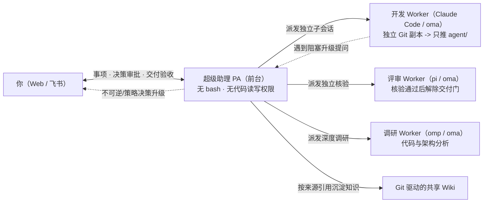
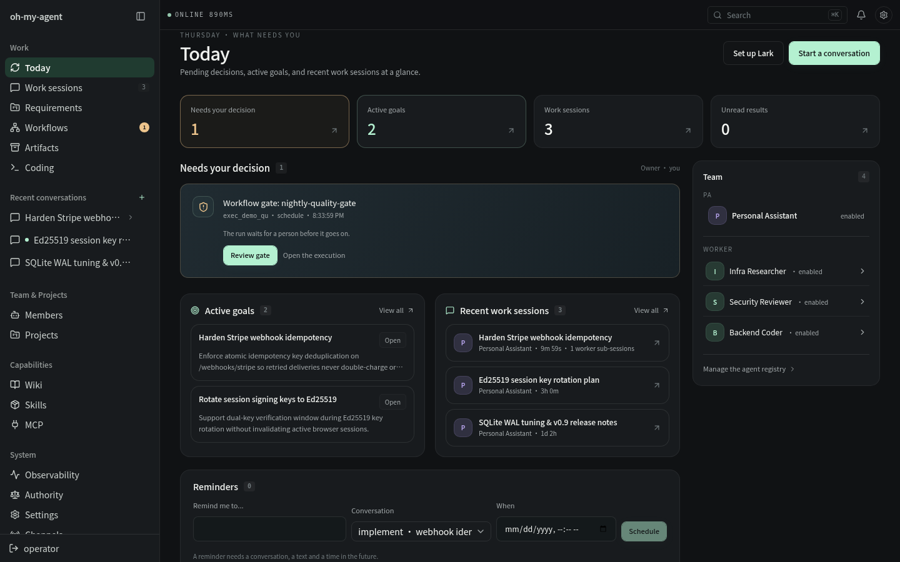
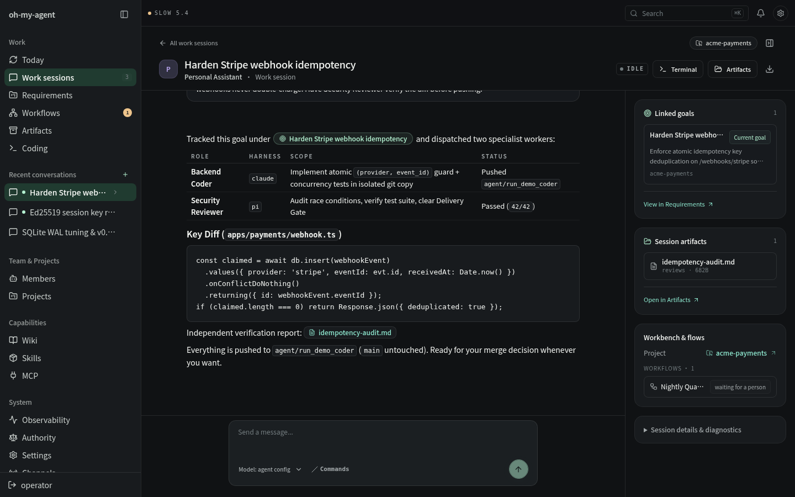
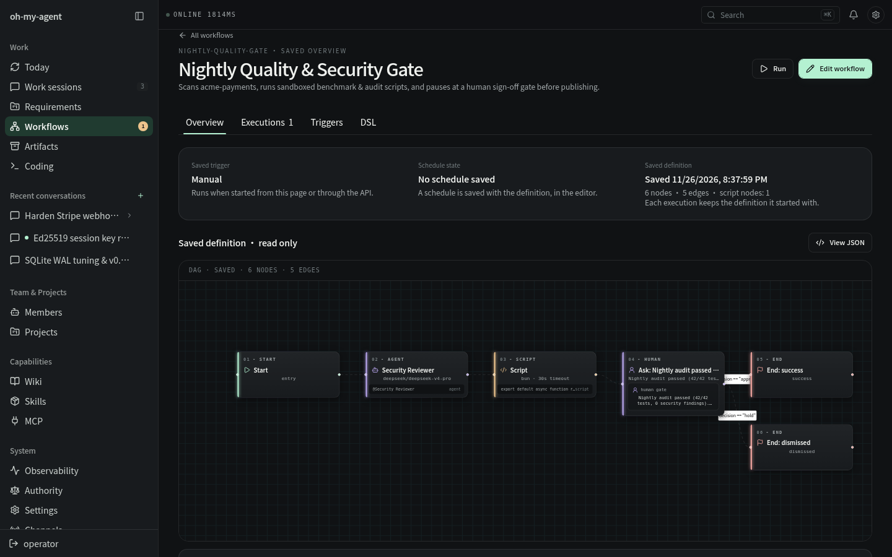
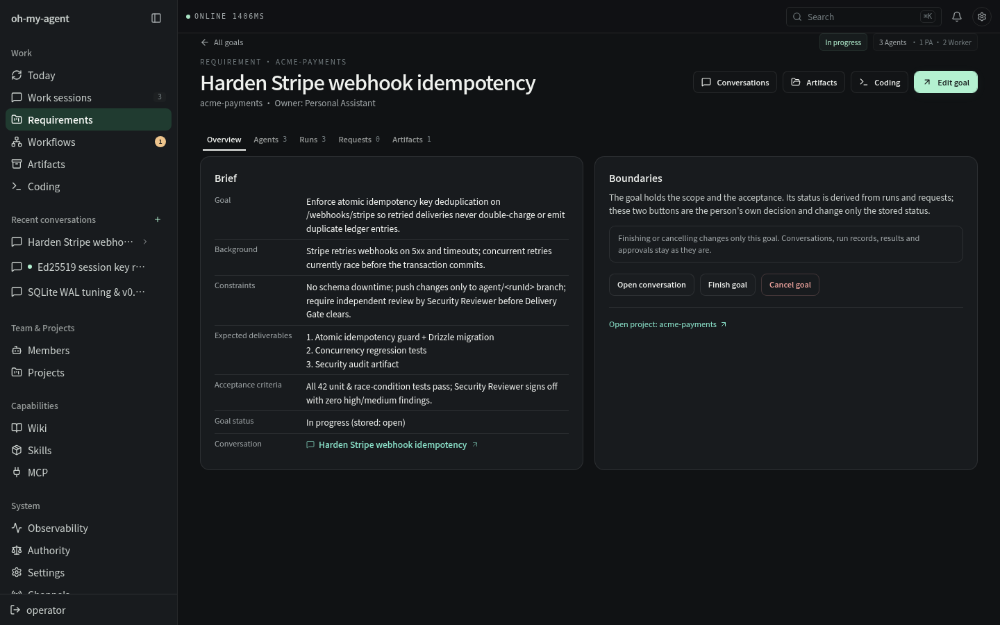
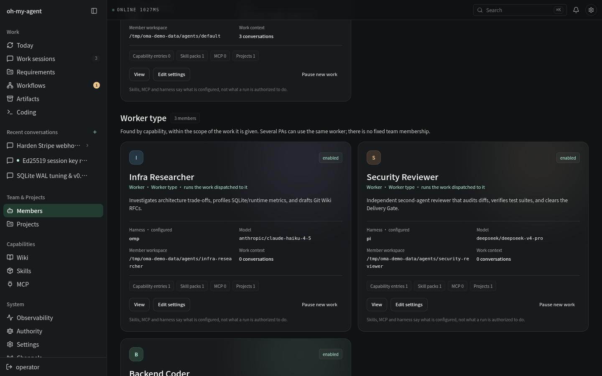
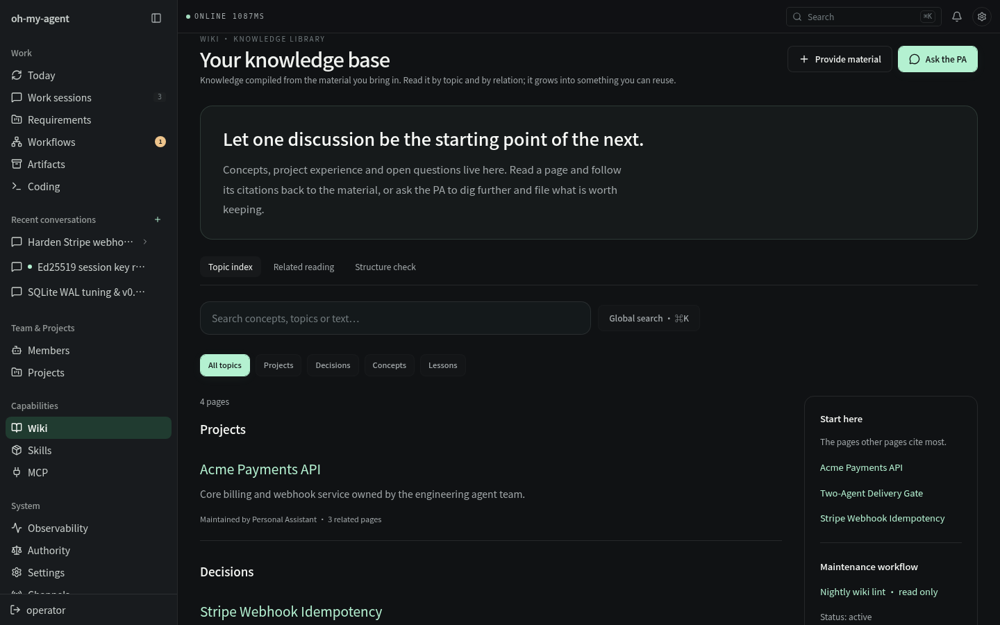
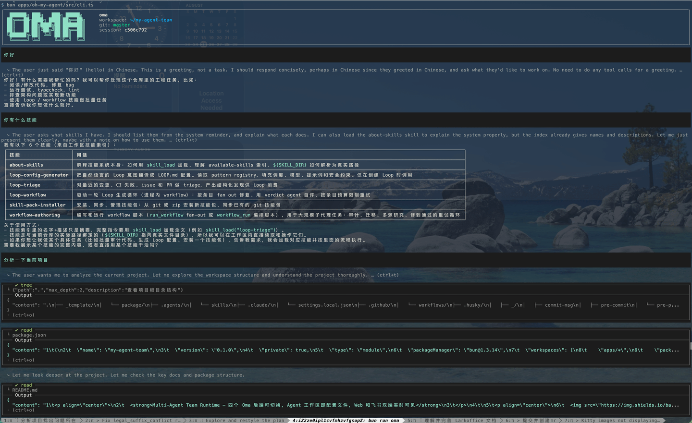
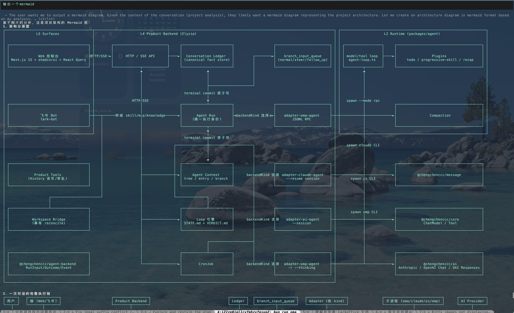
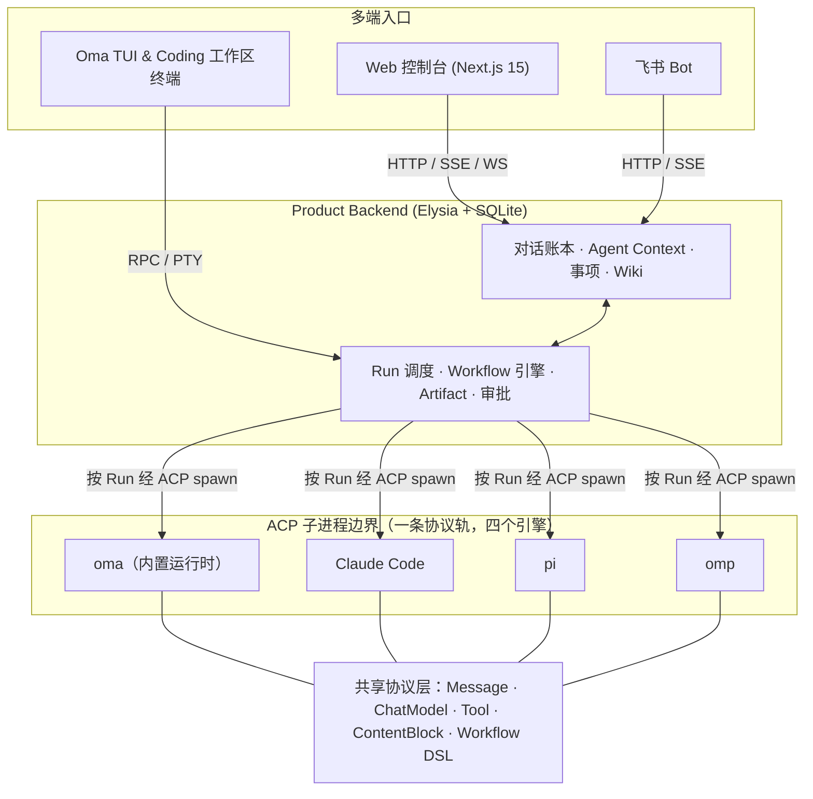

<div align="center">

# CrewDesk

**自托管的 AI 工程团队工作台：一个超级助理统筹多位专职 Agent，统一接入 `oma` / Claude Code / `pi` / `omp` 四种引擎，共享 Git Wiki 与 Web / 飞书实时同步。**

[English](README.md) · **简体中文**

[](https://bun.sh)
[](https://www.typescriptlang.org)
[](https://nextjs.org)
[](https://www.sqlite.org)
[](https://www.npmjs.com/package/@chengchenccc/oh-my-agent?activeTab=versions)
[](https://www.npmjs.com/package/@chengchenccc/oh-my-agent)
[](LICENSE)
[](https://github.com/Chengchcc/crewdesk/actions/workflows/ci.yml)

[PA + Worker 协作模型](#-pa--worker-团队协作模型) · [Skills + MCP 操控](#-用对话操控整个工作台skills--product-mcp) · [界面预览](#-界面预览) · [快速开始](#-快速开始) · [架构设计](#-架构设计) · [安全模型](#-安全模型) · [文档入口](#-文档入口)

<br />

<a href="https://github.com/Chengchcc/crewdesk/releases/download/media-assets/demo-main-flow.mp4">
  
</a>

<sub>主流程演示：Today → 对话与产物预览 → 事项追踪 → 四引擎团队 → Workflow DAG → Git Wiki · <a href="https://github.com/Chengchcc/crewdesk/releases/download/media-assets/demo-main-flow.mp4">下载高清 MP4</a></sub>

</div>

---

大多数 Coding Agent 都困在各自的终端标签页里。**CrewDesk** 用单机 Bun + SQLite 技术栈，把它们组织成一支可协作、可审计、可自托管的 AI 工程团队：

- 在 Web 控制台或飞书里直接找你的**超级助理（PA）**沟通。
- PA 把真实目标沉淀为**事项（Requirement）**，拆解派单给专职成员（开发 / 调研 / 评审）在独立 Git 副本里干活，并把长期经验沉淀进 **Git 驱动的共享 Wiki**。
- 同一支团队可混用 **`oma`**、**Claude Code**、**`pi`**、**`omp`** 四个引擎，走同一条 ACP 协议轨，自带 fail-closed 人工审批与进程沙箱，无需 Docker Compose、Postgres 或 Redis。

## 👥 PA + Worker 团队协作模型

大多数 Coding Agent 把聊天、规划、跑命令和改代码全塞进同一个全能循环里——一次理解偏差就可能直接改坏仓库，或用满屏工具日志淹没对话。

**CrewDesk** 用代码层（而非仅靠提示词）把团队拆成两类硬隔离角色：**一位超级助理（PA）守在前台管注意力**，**多位专职 Worker 在隔离车间里干活**。



### 职责与硬边界（由工具层与运行时强制执行）

| 角色 | 负责什么 | 硬边界（代码级强制，非口头约定） |
|---|---|---|
| **你（操作员）** | 配置团队成员与权限、批准不可逆风险动作、决定最终合并与验收。 | Agent 可以**提议**新建项目、修改流程或成员配置，但「采纳建议」≠「保存」，所有变更必须由你确认保存。 |
| **超级助理 PA（前台）** | 管理你的注意力与主会话：澄清意图、把真实目标建为**事项（Requirement）**、按能力选人派单、跟进进度、基于上下文/Wiki 回复 Worker 提问，并维护**共享 Git Wiki**。 | **物理上没有执行工具**（无 `bash`/`read`/`write`/`edit`/`eval`/浏览器），工作区里也没有代码仓——不会擅自“自己去看看顺手改了”，需要对话外信息就必须派单给 Worker。 |
| **专职 Worker**（开发 / 评审 / 调研…） | 在**独立子会话**和**独立 Git 项目副本**里深度执行，可按成员混用 `oma` / `Claude Code` / `pi` / `omp`，各自持有独立 `SOUL.md`、技能与 MCP。 | 不主动越级打扰人（除非你显式开直连或进工作区终端接管）；`project_push` 只允许推到 `agent/<runId>` 分支（禁止直推 `main`/`master`）；`deny_write_paths` / `deny_commands` 阻止写逃逸。 |

### 一条真实需求的完整闭环

1. **找 PA 提目标**：在 Web 控制台或飞书里说清楚要解决的问题（例如「给 `/webhooks/stripe` 补原子幂等校验，并让评审成员复核」）。
2. **建事项并派单**：PA 把目标沉淀为**事项（Requirement）**（记录目标、约束与验收标准），并向开发 Worker 派发独立子会话与隔离 Git 工作区。
3. **遇阻升级与 Fail-Closed 审批**：Worker 缺上下文时先向 PA 提问，PA 依据 Brief/Wiki 回答或升级成待决卡片交给你；高风险写文件/命令动作停在审批卡上，超时默认拒绝。
4. **二号成员交付门**：开发 Worker 只把改动推到 `agent/<runId>` 并上传带类型的 `artifacts://`。若未经第二位成员（如评审 Worker）独立跑测与复核，后端会自动在交付消息中标注**「未经核验」**；最终由你决定是否合并。
5. **知识复利入库**：过程中的架构决策、根因分析与踩坑记录按来源引用写入共享 **Git Wiki**，不再随聊天沉底。

## 🎛 用对话操控整个工作台（Skills + Product MCP）

在 CrewDesk 里，会话不只是用来写代码——**你可以直接通过对话操控整个控制台的功能**。

成员、项目、工作流等编辑页都内置了侧边 PA 会话面板。输入 `/` 即可点名调用 `skills/` 目录下的内置 **Skill**，PA 经由后端按次注入的三个 **Product MCP** 服务（`product-tools`、`agent-config`、`workflow`，每次 Run 独立临时 token，结束即吊销）读取真实状态并生成改动建议。

**提议 ≠ 保存**：Agent 永远不会偷偷覆盖你的团队配置、项目绑定或工作流定义。所有修改都会渲染为逐字段对比的 **Proposal 卡片**（点击「填入表单」→ 人工审阅 → 显式「保存」才落盘）。

| 斜杠技能 | 背后调用的 Product MCP 工具 | 在会话里能直接做什么 |
|---|---|---|
| `/member_manage` | `team_list`、`agent_read`、`agent_write`、`agent_create` | 查看团队花名册与能力，提议新增成员或修改某个成员的引擎、模型、角色与路径权限。 |
| `/project_manage` | `project_list`、`project_detail`、`project_propose`、`project_attach`、`project_push` | 注册或修改 Git 项目、经人工批准给 Worker 绑定仓库，并把开发分支安全推回 `agent/<runId>`。 |
| `/workflow_design` | `workflow_read`、`workflow_write` | 生成并经 `parseWorkflow` 强校验 `*.workflow.json` 节点图，以未保存提案形式直接送进可视化编辑器。 |
| `/requirement_memory` | `requirement_track`、`requirement_query` | 跨会话持续记录、更新与召回**事项（Requirement）**的目标、约束与验收标准。 |
| `/wiki_manage` | `wiki_query`、`wiki_read`、`wiki_create`、`wiki_patch`、`wiki_lint`、`wiki_source_add` | 检索、按来源引用沉淀、带 CAS 版本号安全更新并巡检共享 Git Wiki。 |
| `/reminder_manage` | `remind_me`、`reminder_list`、`reminder_cancel` | 在当前会话中创建、查看或取消一次性提醒与 UTC cron 周期巡检。 |
| `/agent_doctor` | 工作区记忆 + 对话账本对照检查 | 让一个 Agent 给“跑偏/失忆”的队友做体检，对比账本事实指出记忆漂移并提出具体修复建议（不擅自篡改对方记忆）。 |
| `/agent_fanout` | `task`（单批最多 64 项 / 8 并发）、`workflow_run` | 发起大规模子 Agent 并行扇出（批量审计、迁移、多源调研）或在沙箱 VM 中跑修到通过的编排脚本。 |

> 内置技能采用两段式渐进加载（提示词只带轻量索引，按需调用 `skill_load` 加载正文并解析 `${SKILL_DIR}`），同时支持按 Agent 挂载外部 MCP Server 与 Git/ZIP 自定义技能包。

## ✨ 核心能力

| 能力 | 具体解决什么问题 |
|---|---|
| **一条 ACP 轨，四个 Coding 引擎** | 每个 Agent 可自由选择 **`oma`**（内置 CLI/TUI 运行时）、**Claude Code**、**`pi`** 或 **`omp`**。四个引擎在统一 ACP 子进程边界下各自续接原生 session——切换底层引擎，不影响 Web 控制台、飞书机器人或审批流。 |
| **工作区即配置 & Git Wiki** | 每个 Agent 的身份（`SOUL.md` / `USER.md`）、技能、MCP 服务与记忆都是工作区里的普通文件，人可直接编辑与版本管理。长期知识沉淀在产品级 Git **Wiki**（`raw/` 引用 + 编译后的主题页），不再随聊天记录流失。 |
| **单一账本，多端实时同步** | Web 控制台、飞书机器人、Oma TUI 以及浏览器内的 **Coding** worktree 终端共用同一份 SQLite 对话账本。手机飞书里发需求，电脑 Web 里点审批看产物，一键跳进对应 Agent 的工作区终端。 |
| **人在环审批与权限围栏** | 按 Agent 配置工具策略（`ask` / `auto` / `deny`）与路径/命令护栏（`deny_write_paths`、`allow_write_paths`、`deny_commands`）；审批与提问持久化在 `pending_action`，超时默认拒绝（fail-closed）。 |
| **声明式 Agentic Workflow** | 可视化 DAG 编排器，支持 `agent`、`script`（bubblewrap 沙箱）、`human` 三类节点、JSON-Logic 条件路由、cron 定时触发以及带类型的 `artifacts://` 产物接力。 |
| **零额外基础设施自托管** | 单机 Bun + SQLite 即可运行，无外部数据库与消息队列依赖。 |

## 📸 界面预览

<table>
  <tr>
    <td width="50%">
      
      <br /><sub><b>Today 收件箱</b> — 待决审批门、进行中事项、近期工作会话与团队成员</sub>
    </td>
    <td width="50%">
      
      <br /><sub><b>对话控制台</b> — PA 派单汇总、行内事项与产物卡片、右侧关联面板</sub>
    </td>
  </tr>
  <tr>
    <td width="50%">
      
      <br /><sub><b>Agentic Workflow</b> — Agent / 沙箱脚本 / 人工确认节点可视化 DAG</sub>
    </td>
    <td width="50%">
      
      <br /><sub><b>事项追踪</b> — 目标、约束、验收标准与关联 Run / 产物</sub>
    </td>
  </tr>
</table>

<details>
<summary>查看更多截图（多引擎团队、Git Wiki 知识库、Oma TUI）</summary>

<br />

| 多引擎团队（`oma` · `claude` · `pi` · `omp`） | Git 驱动的共享 Wiki |
|---|---|
|  |  |

| Oma TUI — 交互终端 | Oma TUI — Mermaid 图表 |
|---|---|
|  |  |

</details>

## 🚀 快速开始

### 方式一：安装预编译产物（推荐，最快跑通）

一条命令安装 `oma` CLI 并下发预编译的 backend + web 产物（系统需有 `tar` 与 `zstd`，缺 Bun 会自动安装）：

```bash
curl -fsSL https://raw.githubusercontent.com/Chengchcc/crewdesk/master/scripts/install.sh | OMA_VERSION=rc sh
oma gateway up        # 前台运行；加 -d 放后台，健康后返回
```

> 当前带 `oma gateway` 的版本发布在 npm `rc` 通道，所以需要 `OMA_VERSION=rc`。安装脚本只把产物下到 `~/.oma/gateway/`，不会擅自启动服务。

打开 `http://127.0.0.1:3001/login`，用终端打印的口令登录（口令以 `0600` 权限保存在 `~/.oma/gateway-secrets.json`）。改口令可在 Web **Settings → Login password** 操作，或运行 `oma gateway passwd`。

**常用命令：**

| 命令 | 作用 |
|---|---|
| `oma gateway up` / `up -d` | 启动 backend + web（前台 / 后台） |
| `oma gateway status` | 查看已装版本、进程健康状态与登录口令 |
| `oma gateway down` | 停止后台运行的 gateway |
| `oma update` | 同步升级 CLI 与 gateway 产物（`--check` 仅检查） |
| `oma -p "用三句话总结 docs/architecture/README.md"` | 用 `oma` 直接跑一次命令行问答 |

也可手动安装：`bun add -g @chengchenccc/oh-my-agent@rc && oma gateway fetch && oma gateway up`（Bun 默认跳过依赖的 postinstall，因此 `fetch` 不能省）。程序（`~/.oma/gateway/`）与数据（`~/.oma/gateway-data/`）分开落盘，升级不动已有数据。

### 方式二：从源码运行

**1. 前置条件**
- **Bun `>= 1.3.14`**（`package.json` 锁定下限 `1.3.14`，CI 与发布使用 `1.4.4`）
- **系统依赖**：`ripgrep`、`bubblewrap`、`openssl`（`scripts/predev.sh` 用它生成本地密钥）
- **Anthropic 凭据**：`ANTHROPIC_API_KEY` 或 `ANTHROPIC_AUTH_TOKEN`（使用其他模型厂商见下方折叠说明）

**2. 安装依赖**

```bash
bun install
```

**3. 启动服务**

```bash
export ANTHROPIC_API_KEY=sk-ant-...   # 或 ANTHROPIC_AUTH_TOKEN=...
bun run dev
```

`bun run dev` 会先执行 `scripts/predev.sh`（自动生成 `.env`、随机 `BACKEND_AUTH_TOKEN` / `SESSION_SECRET` / `MOCK_PASSWORD`、补齐 Drizzle 迁移与 Monaco 资产），再执行 `scripts/dev.sh` 启动 backend（`:3000`）与 web（`:3001`）。

**4. 验证运行成功**
- Backend 健康检查：`curl -s http://127.0.0.1:3000/health` 返回 `{"status":"ok"}`
- Web 控制台：打开 `http://localhost:3001/login`，登录口令见 `apps/web` 目录下自动生成的 `.env` 中的 `MOCK_PASSWORD`

<details>
<summary>切换 OpenAI / DeepSeek / Groq / OpenRouter 等模型厂商，以及重置口令与本地库</summary>

<br />

`scripts/dev.sh` 的 Anthropic 校验仅是启动脚本的检查，后端运行时支持任意已配置厂商。如果没有 Anthropic key，分两个终端启动即可：

```bash
bun run predev       # 首次生成 .env 与密钥

# 终端 1
export OPENAI_API_KEY=sk-...
bun run dev:backend  # http://127.0.0.1:3000

# 终端 2
bun run dev:web      # http://localhost:3001
```

内置支持的环境变量：

| 模型厂商 | 环境变量 |
|---|---|
| Anthropic | `ANTHROPIC_API_KEY` |
| OpenAI | `OPENAI_API_KEY` |
| DeepSeek | `DEEPSEEK_API_KEY` |
| Groq | `GROQ_API_KEY` |
| OpenRouter | `OPENROUTER_API_KEY` |

自定义厂商与模型覆盖写在 `~/.oma/models.yml`（gateway 场景的路径隔离限制见「安全模型」）。

- **忘记登录口令**：`MOCK_PASSWORD` 只在全新数据目录首次启动时生效。忘记口令可运行 `bash scripts/reset-login-password.sh` 并重启 backend。
- **开发库升级策略**：迁移只保证 fresh-boot 路径；schema 变更导致旧开发库启动异常时，删除 `apps/backend/.backend-data/` 重启即可。

</details>

## 🏗 架构设计



**核心不变量**
- **Backend 是唯一事实源**：Web、飞书、TUI 只渲染同一份 `conversation_ledger`。
- **单事务终态提交**：每次 Run 收敛为唯一的 `BackendRunOutcome`，在一个 SQLite 事务内原子写入 History 与 Context；流式输出永不污染事实账本。
- **一次性子进程隔离**：每个 Run 启动一个独立子进程，跨 Run 上下文由各引擎原生 session 续接，避免常驻进程状态漂移。
- **Fail-closed 人工审批**：审批与提问持久化在 `pending_action`，超时默认拒绝。
- **路由冻结**：Workflow 条件边在节点完成时求值并冻结进 `CompletionRecord.routedTo`，汇合语义为 `any-of`。
- **配置即文件**：Agent 身份、技能与配置存放在工作区文件中，每次 Run 启动时冻结一份快照。

## 🔐 安全模型

本项目按**单操作员、本地/自托管部署**的威胁模型设计：Web 登录、BFF 与 backend 共享同一个操作员身份，**没有多租户隔离**。请勿将其作为多用户服务直接暴露到公网。

运行时强制执行的安全边界：

- **默认仅监听本机**：服务默认绑定 `127.0.0.1`，不对外暴露局域网端口。
- **成员代码仓隔离**：worker 在独立项目副本里开发，`project_push` 仅允许推送到 `agent/<runId>` 分支（拒绝推送 `main`/`master`）；`deny_write_paths`、`allow_write_paths`、`deny_commands` 阻止写逃逸与越界 git 操作。
- **Workflow 脚本沙箱**：script 节点默认关闭（需显式设置 `WORKFLOW_SCRIPTS_ENABLED=1`），开启后运行在 `bwrap` / `sandbox-exec` 沙箱中（无网络、独立 PID namespace、禁止读取 `dataDir` 与 `.env`）。
- **飞书发送者白名单**：入站消息受 `agent.lark.allowed_senders` 的 `open_id` 白名单约束，bot 发出的消息一律丢弃。
- **密钥全服务端脱敏**：模型 API key 与 MCP headers 仅存服务端，所有 HTTP 读取接口一律脱敏。
- **模型配置隔离**：被拉起的 Agent 子进程只读取 `$OMA_HOME/models.yml`，不读 Agent 可写工作区，防止一次 Run 篡改下一次 Run 的 `baseUrl` 或密钥。

## 📦 仓库结构

```text
apps/
  backend/       Elysia 后端 — HTTP/SSE、对话账本、Run 调度、Workflow、Wiki、Artifact、产品 MCP 工具
  oh-my-agent/   Oma CLI 与运行时 — print / json / tui / acp 模式、agent loop、插件与上下文压缩
  web/           Next.js 15 控制台 — Today、对话、事项、团队、Workflow、Coding 终端、Wiki、渠道
  lark-bot/      飞书 Bot 适配器

packages/
  message/       协议层：Message、ChatModel、Tool、ContentBlock 与流处理工具
  ai/            多厂商模型注册表与协议适配（Anthropic、OpenAI、DeepSeek 等）
  workflow/      Agentic Workflow DSL 纯域层（节点图、JSON-Logic 路由、computeNext 引擎）
  sandbox/       进程沙箱（用于 workflow script 节点与 oma eval 工具）
  adapter-mcp/   外部 MCP Server 客户端接入
  ahp-client/    Agent Host Protocol 的 WebSocket 传输与状态镜像
  api-contract/  跨进程类型契约（SSE 事件、Eden Treaty）
  embedding/     本地向量嵌入支持
  source-fetch/  Git / 压缩包源物化基座
  tui/           终端 UI 工具箱（编辑器、Markdown、Mermaid）
  config/        配置加载器
  test-helpers/  确定性测试桩（echoModel）
```

**常用开发命令：**

```bash
bun run format          # Biome 格式化
bun run lint            # Biome + ESLint 检查
bun run typecheck       # 全仓 tsc --noEmit
bun run test            # 全仓测试（turbo）
bun run build           # 全仓构建（turbo）
bun run audit           # 契约 / 工作区 / 文档 / UI 四道快门禁
bun run audit:coverage  # oma 运行时与后端核心文件的覆盖率底线
bun run quality:mutate  # 按需变异测试探针
```

## 📚 文档入口

| 文档 | 内容 |
|---|---|
| [项目 Wiki](docs/README.md) | 架构现状、ADR 决策记录、开发指南与路线图 |
| [架构总览](docs/architecture/system-overview.md) | 唯一执行链、模块所有权与核心不变量 |
| [设计哲学](docs/architecture/design-philosophy.md) | 指导本仓库架构决策的八条原则 |
| [开发指南](docs/guides/development.md) | 本地开发、测试与提交前检查 |
| [贡献指引](CONTRIBUTING.md) | 提交规范与 PR 流程 |

## 📄 License

本项目基于 [MIT License](LICENSE) 开源。
