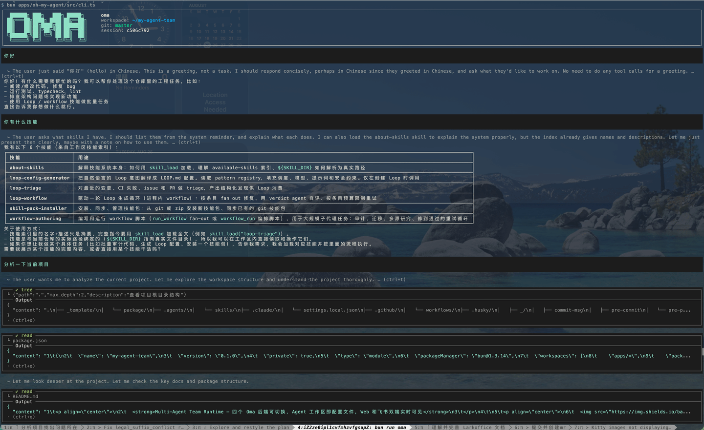
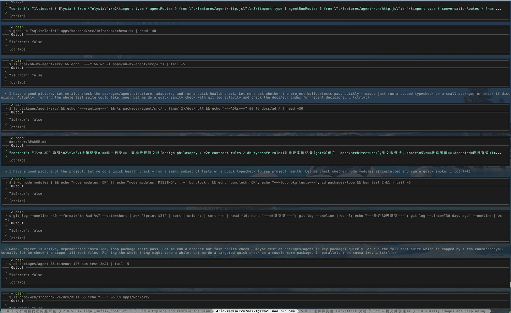
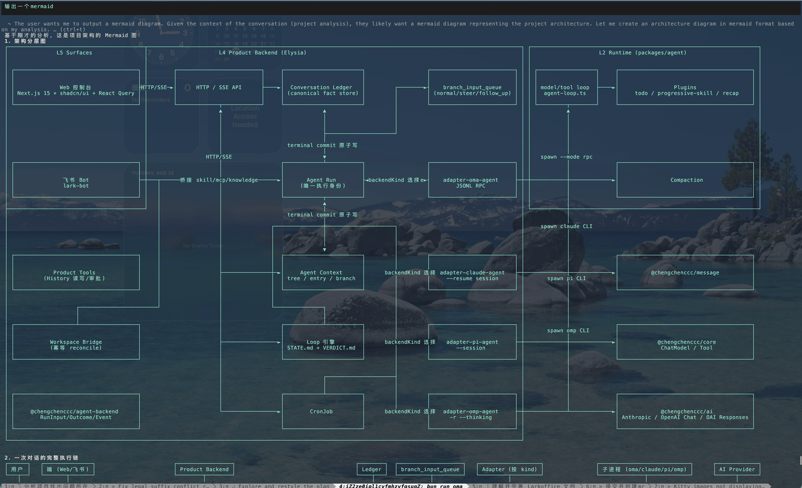

# @chengchenccc/oh-my-agent

Oma 是本仓库自研的 Agent CLI 与执行引擎：既可**独立交互式 TUI**（默认 `oma` 进入终端界面）或**无头 CI 运行**（`print` / `json`），也可经 **ACP 面**（`--mode acp`）被 Product Backend 按**每个 Agent Run** spawn 一次（ADR 0039/0040）。

```text
Product Backend → Agent Run → ACP Client → spawn oma --mode acp
→ per-Run Runtime → ACP prompt response & updates → child 退出
```

**不是 daemon**（就 Run 执行模型而言）：一个 Run = 一个子进程 = 一个 Runtime = 一个 outcome。没有常驻的 session supervisor，没有 worker pool。同一个包里的 `core/gateway/` 是另一回事——`oma gateway up -d` 确实会起一个 detached daemon，那是它自己的 pidfile 加 supervisor，与 Run 无关（且 `main.ts` 按模式懒加载，Run 进程不会加载 gateway/update 或 TUI 代码）。

## TUI 与独立 CLI 能力

用 `oma`（或 `oma --session <id>` / `oma -c` / `oma -w [<name>]`）在终端直接开始交互式会话；首次在无可用模型的终端启动时自动进入 `oma setup` 配置向导。

- **流式交互与快捷键**：`Shift+Tab` 循环切换 `ask → auto → plan`，`Ctrl+P` 切模型，`Ctrl+R` 搜历史，`Ctrl+V` 粘贴剪贴板图片，`Ctrl+O` 展开 tool 详情，`Ctrl+T` 展开 thinking，`Esc` 中止（空闲 `Esc×2` 分支树 fork），`!cmd` 本地执行 shell，`@file` 模糊文件引用，mermaid 代码块渲染为终端 ASCII 图
- **安全回滚与成本透明**：每轮前异步采集 git 影子快照（不碰 `.git/index` 与 gitignored 文件），支持 `/diff [<file> | restore <file>]` 与 `/rewind [<turn>]`；状态栏实时显示权限芯片、推理强度、MCP 报错芯片与 USD 花费，配合 `/cost`、`/effort`、`/export`、`/doctor`、`/init`
- **三层配置与模式级权限规则**：按 `~/.oma/settings.json`（用户全局）→ `.oma/settings.json`（项目共享）→ `.oma/settings.local.json`（本地覆盖）合并；支持 `bash:bun test*` / `edit:src/*` 规则白黑名单（`deny` 恒胜 `allow`，bash 前缀允许规则自动拦复合/注入语法），审批面板按 `[p]` 一键持久化，`/permission allow|deny|rules|clear-rules` 管理
- **并行隔离与无头 CI**：`-w / --worktree [<name>]` 在 `.oma/worktrees/<name>` 创建独立 worktree（退出时零改动自动清理，有改动保留分支）；无头模式支持 `--max-turns`、`--max-budget-usd`（动态收紧 provider 侧 `maxTokens` + 零外发 fail-fast）、`--output-schema <file|json>` 与管道 stdin
- **子代理与动态编排**：`task` / `hub` 子代理并行扇出，以及沙箱内 JS 编排引擎 `orchestrate` 工具 / `/orchestrate`（支持 `agent()`、`parallel()`、只读 `tool()`、`phase()`）
- **持续驱动模式**：`/plan`（只读规划）、`/goal`（目标自主循环）、`/loop`（含 `ralph` 队列与 `--while`/`--until` 条件）

| Real session | Tools | Mermaid |
|---|---|---|
|  |  |  |

## CLI 子命令与模式

| 入口 / 模式 | 用途 |
|---|---|
| `oma setup` | 交互式配置 provider 与 API key（写入 `~/.oma/models.yml`） |
| `oma doctor [--json]` | 诊断运行环境、模型目录、工具链、OS 沙箱、配置与 MCP 信任状态 |
| `oma gateway <verb>` | 管理 detached Product Backend + Web 网关（`up`/`down`/`fetch`/`status`/`doctor`/`passwd`） |
| `oma update [--check]` | 检查或升级 CLI 与 gateway 发布包 |
| `tui` | 默认；交互式终端会话（一个进程 = N 个 Run 共享一个 session 文件） |
| `print` | 一次 Run；stdout 只有 final assistant text；stderr 日志；非零退出码表示失败 |
| `json` | 一次 Run；stdout 全部事件 JSONL + 恰好一个 terminal outcome 行 |
| `acp` | Product Backend 与外部 ACP 客户端使用的协议面（Agent Client Protocol over stdio；stdout 仅承载 JSON-RPC 协议，支持 MCP-over-ACP、审批卡片与 `_session/steering`） |

## Runtime

`createOmaRuntime()`（`src/core/runtime/create-runtime.ts`）构造一个 Runtime = 一个 Run：

- `run(input)` 返回唯一 segment，其 `outcome` 是 Run 的唯一终态；
- `steer(input)` 注入 live loop；`stop()` 中止；
- `close()` 拆除 MCP clients 与 SessionStore。

Runtime 主体在 `src/core/runtime/`：OmaSession（model/tool loop、retry、compaction、插件、todo、tool-result pruning）与 in-memory SessionStore（`core/store/`）。in-memory store 随 Run 销毁，但子进程会把本轮写进自己的 session 文件（`core/session/` 的 JSONL），并通过 session id 跨 Run 恢复。

## 运行

```bash
bun run --cwd apps/oh-my-agent dev -- -p "hello"    # source CLI (dev)
bun apps/oh-my-agent/src/cli.ts -p "hello"          # source CLI, direct

bun run --cwd apps/oh-my-agent build                # → dist/cli.js (executable)
./dist/cli.js -p "hello"                            # built binary (inside apps/oh-my-agent)

cd apps/oh-my-agent && bun link                     # optional local install
oma setup                                           # Day-0 provider setup
oma doctor                                          # diagnose local environment
oma -w fix-auth                                     # isolated git worktree TUI
oma -p "audit" --max-turns 10 --max-budget-usd 0.5  # headless CI with hard budget cap
```

- 正常由 Backend 通过 `OMA_BIN` spawn（生产：构建后的 `dist/cli.js` 绝对路径；未配置时 Backend 自动用 Bun + 源码入口，dev 无需全局安装或 `bun link`）。
- `dist/cli.js` 带 `#!/usr/bin/env bun` shebang，构建脚本会设置可执行位。

## 目录

```
src/
  cli.ts                可执行入口（shebang + runCli()）
  main.ts               main()/runCli()：参数解析、worktree 隔离、按模式懒加载分发、退出码
  version.ts            零依赖包版本读取
  cli/                  args、initial-input、setup-wizard、doctor-command、worktree、gateway/update 子命令
  modes/                tui / print / json / acp 模式
  core/
    runtime/            create-runtime、run-runtime、agent-loop、run-permissions、permission-rules、cost
    session/            session 文件（JSONL）：paths、file、fork、markers、checkpoints、export-markdown
    settings/           project-settings.ts（三层配置合并与信任门）+ workspace-context.ts
    delegation/         子代理执行器（task / yield / roles / pool）
    orchestrate/        沙箱 JS 动态编排引擎（orchestrate 工具 / /orchestrate）
    coordination/       后台任务与子代理句柄账本（hub 工具）
    memory/             自主记忆提取与混合向量召回（.oma/memory/memory.db）
    loops/ goals/ plans/  三种持续模式的状态机与工具面
    gateway/            `oma gateway` 的 daemon、supervisor、doctor、artifact
```

## 相关文档

- [Oma Runtime](../../docs/architecture/oma-runtime.md)
- [Skills & Plugins](../../docs/architecture/skills-and-plugins.md)
- [Models & Providers](../../docs/architecture/models-and-providers.md)
- [ACP Backend Contract](../../docs/architecture/acp-backend-contract.md)
- [Security Model](../../docs/architecture/security-model.md)
